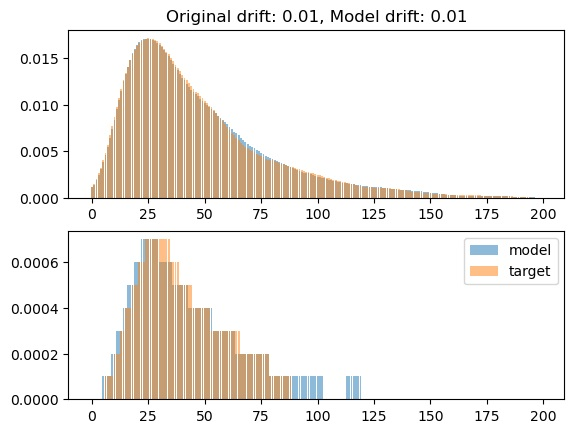
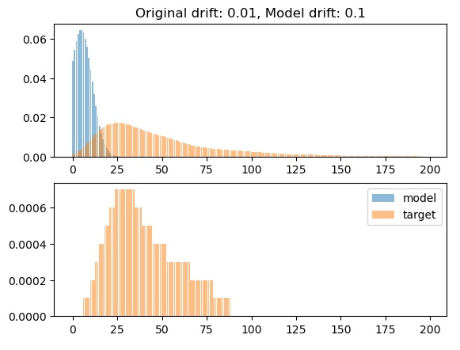
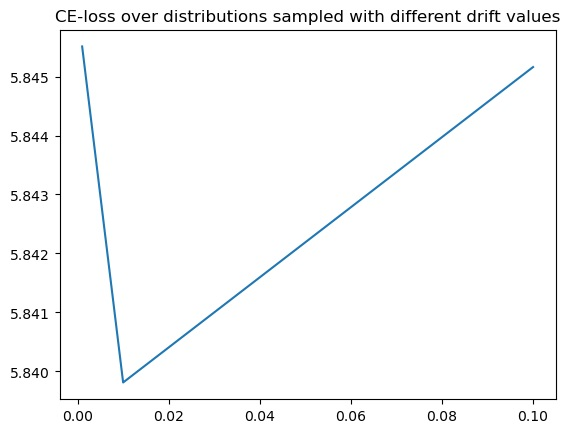
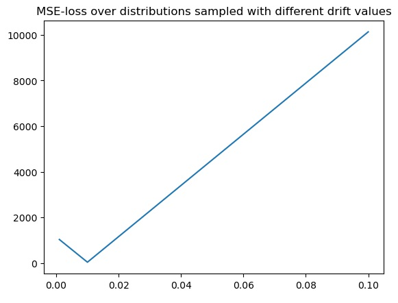
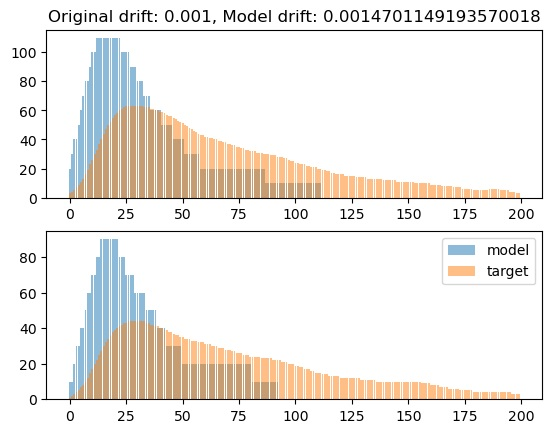
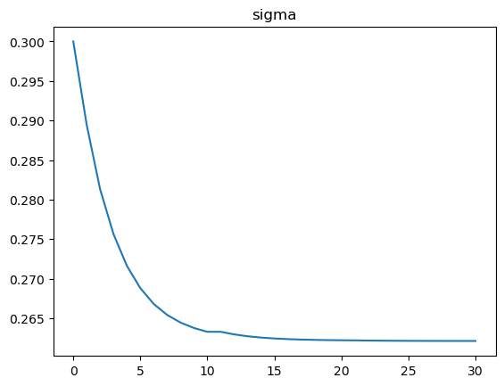
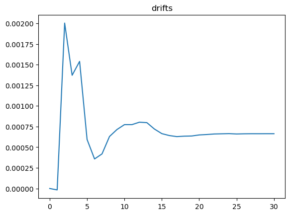

# DDM RNN
This repository aims at providing a (recurrent) neural network that fits the parameters of a drift diffusion model (DDM) with supervised learning and backpropagation. This is currently work in progress, so things like providing background resources, cleaning up old code and further documentation are far from finished. As of now, the implementation only considers the drift rate and the amount of noise, a fitting process for the parameters z0, and nrt will be the next step (note that the threshold parameter is already entailed by the relation of drift vs. noise wrt the given threshold of one).

## Why is this not trivial
The main problem of this approach is, that the main output of a DDM is the amount of timesteps that it takes to reach a threshold. However, timesteps are not differentiable. One could say, that using supervised learning for training a DDM RNN is a really bad idea, for instance Reinforcement learning or simply Hebbian learning usually provide better ways to approach non-differentiable learning tasks. Additionally, the noise during the training make gradients random and hence the overall learning more like random learning than actual gradient descent. The main motivation for this project, was rather making the impossible possible and during that explore completely new ways of using ANNs.

So a lot of "tricks" have to be applied. These tricks are not yet mathematically proven to actually provide the desired results and they most likely introduce a lot of unintended biases.  They are mainly driven by intuitions and numerical experiments of possible strategies. This way of working requires a lot of creativity, requires questioning and deepening already learned concepts and makes a crazy amount of fun, I strongly recommend doing things like this once in a while:D

## TL;DR
In the below, the whole journey of me approaching this problem is documented (on a high level, only, still lots of text). For the most recent and so far most promising results you can skip to the [Fitting P(z|t)](#fit_prob) Section. For a proof of concept approach that sucessfully fits parameters for modeling the mode of the trained on data, see the next section ([The one-sample training approach](#one-sample)). If you are simply interested in an at least somewhat understandable (in contrast to pytorch, etc.) implementation of neural networks as graphs that can be backpropagated through, you can find it in the notebook `ddm_backprob.ipynb`.

## <a name="one-sample"><\a>The one-sample training approach 
Each forwad run of the training network provides an estimated reaction time as well as a binary outcome, that is meant to represent a binary choice (e.g. "correct/wrong answer", "up/down", "stop/go"). Any loss criterion, that compares single outcomes with some training data, will always be optimal (i.e. minimal) if and only if the mode of the distribution of training values is predicted. In my own experiences, even methods that actually make sense to be used for fitting DMM parameters, like MCMC, also suffer from this "predicting mode optimizes training criterion" problem. However, it serves as a nice entry point for analizing the properties of a new approach and can later be extended towards the comparison of outcome distributions instead of individual datapoints. Additionally, it is the more "natural" way of approaching things, if you come from a machine learning background, like me.

The notebook about one-sample training contains a working example for training a network that succesfully learns the mode of the data distribution. The model that is proposed in this notebook does so, by decreasing the noise until qualitatively determinism is reached. Additionally the drift gets fit accordingly (so it converges to a "wrong" value, but one that produces the "correct" output aka the mode).

So why should we even bother? The one-sample training serves as (extendable) proof-of concept for three major questions: is it possible to train a neural network without activation function (technically the thresholding serves as activation function and also introduces the non-linearity which is usually required for ANN training), is it possible to design a differentiable loss function out of the non-differential distribution of reaction times/timesteps and is it possible to learn a noise value, avoiding that normally distributed gradients cancel each other out.

After showing that these things work in general, we can move on to using batches of samples for creating a bootstrapped distribution as output for deriving a loss that considers not only the mode but the whole training distribution.

### Making it differentiable trick
The main trick is to simply assume, that z values after reaching a threshold criterion are exactly 1 (or zero for the lower threshold). A trick for actually making them one, could be by assuming a copy of the value as a constant (learning bias!) and using that constant for making the value become one (e.g. y-(y.detach()-1) for the upper threshold). Alternatively, another trick could be taking the mean of z at the step after breaking the threshold and the one from one step before, which should be much closer to one. Both tricks have not yet managed to produce better results, but it might be good to keep them in mind for later use.

The supposed to be almost one value then gets compared to the value of the cumulative training distribution, which has been normalized such that it has a value of one at the position of the original mode. 

Intuitively speaking, whenever the network produces a reaction that is too slow, the training signal "tells" the optimizer that the value should not have been one but smaller. This results in a positiv gradient, that gets substracted from the drift, hence making the model "slower". Vice versa for being "too fast". I also did something so that the marginal distribution (aka is the mode of the lower threshold reactions bigger than the one of the upper threshold reactions?) gets learned, honestly right now forgot what (I did experiment with scaling the gradients wrt the amount of up/down reactions, but not sure if that was the answer).

The noise parameter gets trained in a way which might feels more like reinforcement learning than supervised learning: If you get large noise (aka noise that is not canceling itself out over a trajectory) that will usually lead to a "worse" loss and relatively large gradients (in a random direction). For good runs the gradients get smaller. So small/good noise values correlate with small gradients (still in random directions). Hence I conjecture, that even though the gradients would on average be cancelling each other out, in practice when a good noise value is (coincidently) found, it will stay good and not change much. Further analysis of this could be interesting.

### The one-sample Code
The neural network and the training procedure for the one-sample scenario was written completely from scratch and without any of the usual ANN frameworks (torch etc). So the implementation is quite wacky and not very efficient. However, efficiency is not an iussue (yet...) and I think explicitly writing down each step of training a neural network makes the code much better for teaching or understanding. But the main reason was that this way I am much deeper involved in the code and able to perfectly understand each step. So this will stay in the project, even though it feels unprofessional.

## Training based on Output Distribution Comparison
If we want to train all parameters of the ddm, we gotta make sure that a non-zero noise value can actually contribute to decreasing the loss value. In a deterministic DDM, we can only ever produce a single rt as well as response value, so noise is nessecary if we want to optimize a loss that takes distributions into account (and noise being necessary is good for us).

### Cross-Entropy Loss
The most "natural" choice for a loss function that is supposed to compare distributions with each other, would be the Cross-Entropy loss (gotta link some blog post here). It is ideally used in scenarios, where you have a (normalized by softmax) confidence value that a network produces and that reflects the (modeled) probability of a datapoint belonging to a certain class and compare that to the one-hot encoded class label (i.e. the probability distribution over all classes with all of the probability mass assigned to the true class). Using a one-hot encoded vector as the  second distribution of a cross entropy function has the nice side effect, that the loss has a lower bound of exactly 0.

However, cross entropy-loss has also been used for comparing a modeled distribution with a target distribution, that is not one-hot encoded. Then the lower boundary (if I remember correctly) is the entropy of the target distribution, which is a much harder to interpret value and one that is usually closer to actually bad loss values.

The non one-hotness of the target disribution was also a problem in this scenario: loss values produced by bad parameters were extremely close to the loss values of a model with the true parameters, resulting in an extremely shallow loss-surface. In theory this problem can maybe solved, but even with ludicrous amounts of learning rate i did not make it working. So this approach has been shelved for now, but will probably be revisited in the future.

*Comparison of output distributions of two models with the same parameters*

*Comparison of output distributions of two models with differing drift*

*Simple loss surface for cross-entropy loss and over three different drift values. Note that although the distributions are drastically different, the loss values only differ in the third decimal place.*

### MSE-loss
So the next best thing should be the MSE-loss (or more precisely the L2-loss, potato-patato). Some prior testing showed a much steeper loss-surface and first runs using this also produced much better results (aka parameters actually started changing in an at least somewhat meaningfull way.

*Simple loss surface for cross-entropy loss and over three different drift values. Since we do not require distributions as inputs, we can just take the amount of values (absolut frequencies) into consideration, resulting in a much steeper loss-surface.*

*Comparison of the training distribution with the outputs of a somewhat good training result after convergence to a local minimum. At least it seemed like convergence since the parameter values were not changing anymore, however it is thinkable that with a (much) longer training time a better optimum could have been reached by slowly and steadily finding lower sigma values.*

### Implementation
Because keeping track of all the forward passes that are needed to sample a feasible amount of trajectories in order to bootstrap a somewhat representative model distribution is quite cumbersome (and nearly impossible to implement in a somewhat efficient way) at the latest now a torch implementation is required. Additionally torch is of course much more efficient than my own implementation and efficiency is starting to get really important at this point (remember: one training step now consists not of a single forward pass, but in my case 1000).

The network in torch is comically small: it consists of a single (recurrent) layer with a single neuron, that has one weight (sigma) and the bias (drift) and a plus operation that adds the prior z value.

However, at this point training started to get really time consuming and hyperparameter testing gets really impaired by this. As a work around, a buffer was implemented to collect and remember generated samples. After each update step, a tenth of the buffer gets discarded and replaced by new samples. Since the general behaviour of the model did not change, this method allowed for trainig being almost as fast step-wise and each step being roughly eight times faster.

### Grid Search
With the biggest efficiency issue being somewhat leviated, now its the time for doing intensive grid searches over hyperparameters. Especially the initialization values have shown to make a huge impact on the training process. Results will come soon.

As a preliminary observation, the model seems to still be pretty bad at learning a decent noise value. It might be possible, that the RL likeness argument for training noise does not hold in this setting anymore, or at least would require a lot more brute forcing. Additionally, individual learning rates for noise and drift respectively could be required (aka a much much higher learning rate for the sigma parameter). Since this is not possible with plain torch, the simplest solution will be changing the torch implementation that is used in the projects requirements (which is of course a deadly sin programming wise, but then again torch could have made changes like this possible in the first place...).

## Fitting P(z|t)
The next approach will be using the true distributions for approximating the probability distributions over z at any given t. The loss then increases the likelihood of the z-values of our train model at all t values, meaning each training step consits of running the ddm until the maximum amount of steps is reached. No threshholding is done.

This way the information of the whole distribution is taken into account as goodness criterion, all steps are fully differentiable and noise is still nessecary so the model can account for the different modes of the two distributions ("wrong" vs. "correct").

However, predicting the probability distributions over z can be a bit challenging, so far I have assumed that (independant of the variance) it should be maximized at the mean, which should be at $|corrects|_t/(|corrects|_t+|wrongs|_t)$ and the MSE between predicted z and apprximated average true z was used to optimize the likelihood. One problem of that approach is, that the variance of z increases with each timestep, leading to the later parts of trajectories dominating the MSE. Hence, I implemented a loss that could be called $l_{1/2}-loss$ and takes the square-root differences into account (so it is not a norm anymore, but still assigns higher values to larger distances and its square is loosely comparable to a softer version of the Manhattan Distance).

Results are turned out better than expected. For data that was generated in a DDM with sigma=0.2 and drift = 0.02 the parameters sigma=0.262 and drift=0.00066 were recovered. The still somewhat big difference to the original values is not surprising, since the loss function is heavily biased (especially to the end, the probability of reaching a threshold in the direction of the drift is heavily underrated). More importantly, the values converged pretty stable (Figures below), which is far from trivial in a setup like this. Hence I conjecture, that the found approach can be used as some sort of boundary (e.g. $sigma_{true} \leq sigma_{fitted}$ and $drift_{true} \geq drift_{fitted}$).

The next step will be an extensive analysis of the different z-distributions over all timesteps in a whitebox model, in order to find general solutions for a better approximation of them.

## File Structure
For now, all scripts (many of them are left overs from previous projects that are not exactly made with this one in mind) are kept in `ddm.py`.

The self made implementation of the neural network for doing one-sample training can be found in `ddm_backprob.ipynb`. Please note, that there is still a lot of clutter from the beginning of the implementation process.

The torch based ddm implementation for the distribution based training can be found in `torch.ipynb`.
